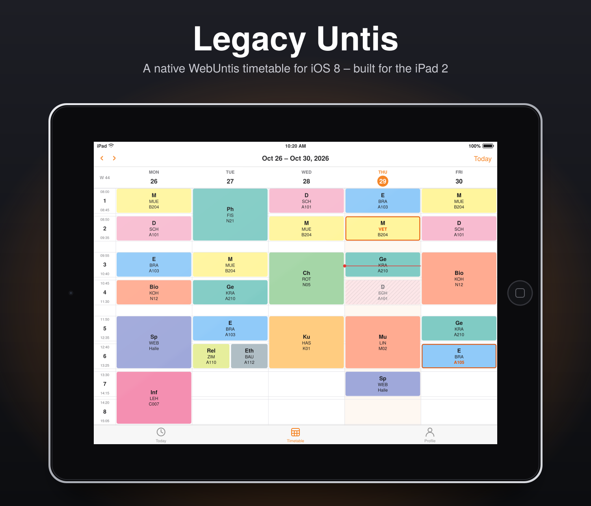

<h1 align="center">
  <br>
  Legacy Untis
</h1>

<p align="center">
  A native <b>WebUntis</b> timetable app for old iPads.<br>
  Built for the <b>iPad 2</b> on <b>iOS 8.4.1</b> · armv7 · jailbreak required
</p>

<p align="center">
  
</p>
<p align="center"><sub>Preview rendered with sample data using the app's own layout rules. Replace with a real screenshot if you like.</sub></p>

---

## Features

- **Week view** that looks like the Untis app: period column, colored lessons, today highlighted, live time marker
- **Cancelled lessons** (hatched, struck through) and **substitutions** (orange border, changed teacher/room in orange)
- **Today tab** with a card per lesson and a "Now" highlight
- **Lesson details** (teacher, room, class, info text, what was changed)
- **Works offline**: every week you open is cached and shown instantly, then refreshed
- **No proxy needed**: talks straight to your school's WebUntis server (JSON-RPC)
- English and German, picked from the iPad's language
- Light on RAM and CPU, made for a 2011 iPad

## Requirements

- Jailbroken iPad on **iOS 8.0 or newer** (32-bit / armv7: iPad 2, 3, 4, mini 1)
- **[TLSFix](https://github.com/ObscureMosquito/TLSFix)** so the iPad can open modern HTTPS servers.
  Legacy Untis depends on it, so Cydia installs it automatically once its source is added.
- A WebUntis account of your school

## Install (Cydia)

1. Install TLSFix by following its [README](https://github.com/ObscureMosquito/TLSFix).
2. In Cydia go to **Sources → Edit → Add** and enter  
   `https://LetsPlaySimi.github.io/legacy-untis-ios/`
3. Search for **Legacy Untis**, install, and respring if asked.

TLSFix works system-wide, so there is nothing to enable. If login fails with a TLS or certificate error, make sure TLSFix is installed and respring.

## First launch

Enter the same values you use on the WebUntis website:

| Field | Example |
|---|---|
| Server | `xyz.webuntis.com` |
| School short name | the `school=` value in your WebUntis URL |
| Username / password | your normal login |

The password is stored in the iOS Keychain (or in the app's preferences if the keychain isn't available on your jailbreak).

## Build from source

Needs [Theos](https://theos.dev) and an iOS SDK that still contains armv7 (the iOS 10.3 SDK from
[theos/sdks](https://github.com/theos/sdks) works). Deployment target is iOS 8.0.

```sh
git clone https://github.com/LetsPlaySimi/legacy-untis-ios.git
cd legacy-untis-ios
export _THEOS_PLATFORM_DPKG_DEB_COMPRESSION=gzip   # old dpkg can't read newer compression
make package                                       # -> packages/*.deb
make package install THEOS_DEVICE_IP=<ipad-ip>     # optional: install over SSH
```

The linker flag `-undefined dynamic_lookup` in the Makefile is intentional: it works around
`_objc_msgSend_stret` not resolving when linking armv7 from Linux.

### Publishing your own repo

The `docs/` folder is a ready-made Cydia repo (serve it with GitHub Pages: *Settings → Pages → main / docs*).

```sh
scripts/configure.sh <github-user> "Your Name" you@example.com   # once
make package
scripts/update-repo.sh                                           # needs: sudo apt install dpkg-dev
git add -A && git commit -m "Release" && git push
```

## Privacy

Your credentials and timetable data only go to the WebUntis server you enter. Nothing is sent anywhere else,
and there is no analytics.

## Disclaimer

This is an unofficial, community project. It is **not affiliated with, endorsed by or supported by Untis GmbH**.
"Untis" and "WebUntis" are trademarks of their respective owners. The app icon is an original design.
Use it at your own risk and follow your school's rules for WebUntis access.

## Credits

Inspired by the original *legacy-untis* web client. Thanks to the TLSFix authors for making modern HTTPS
possible on old iOS.
